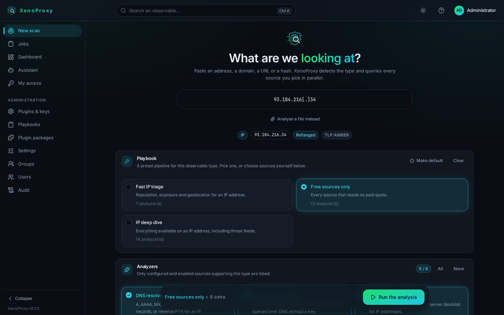
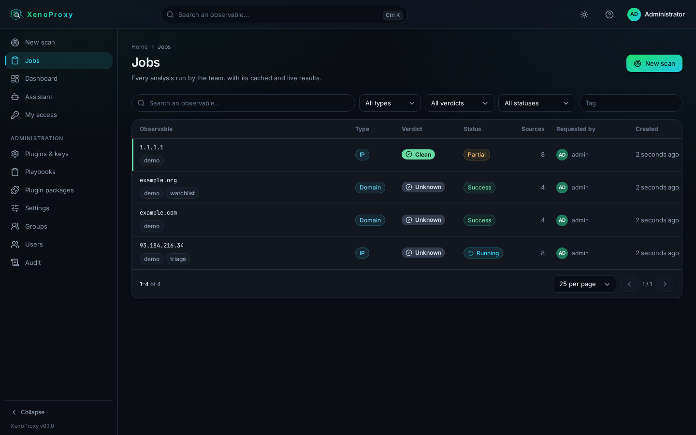
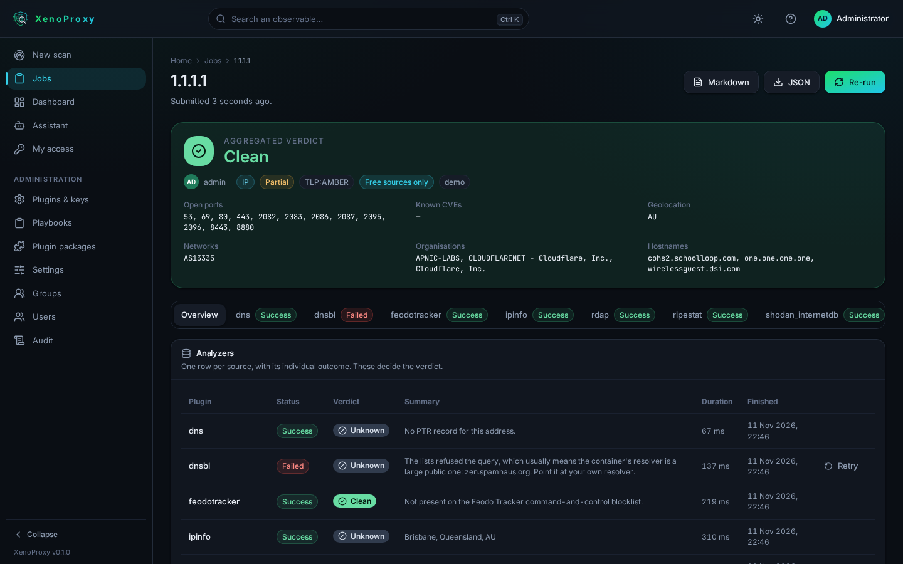
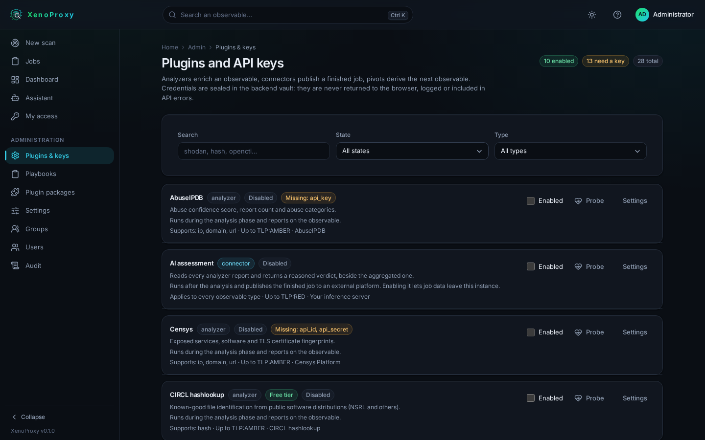

<p align="center"></p>

# XenoProxy

[](https://github.com/emeryn/XenoProxy/actions/workflows/ci.yml)
[](LICENSE)
[](backend/pyproject.toml)
[](frontend/package.json)
[](docs/README.md)

**One interface over every OSINT source your team pays for.** Submit an observable — an
address, a domain, a URL, a hash — and XenoProxy detects its type, runs the sources you
pick in parallel, aggregates a verdict, and keeps the result for the whole team.

The API keys stay in the backend. Analysts never see them, and a lookup an analyst already
made this morning costs nothing when a colleague repeats it this afternoon.

## Screenshots

|  |  |
|---|---|
| <br><sub>**New scan** — the type is detected as you type, and only the sources that can run on it are offered.</sub> | <br><sub>**Jobs** — the team's history, with who ran what and the verdict at a glance.</sub> |
| <br><sub>**Job detail** — the aggregated verdict, one tab per source, and the raw payload underneath.</sub> | <br><sub>**Plugins & keys** — credentials, timeouts, cache windows and what each provider expects.</sub> |

## What you get

- **[22 analyzers](docs/plugins.md#analyzers)**: Shodan and Shodan InternetDB, Censys,
  VirusTotal, AbuseIPDB, URLScan, Onyphe, IPinfo, Joe Sandbox (free cloud and on-premise),
  the abuse.ch feeds, CIRCL hashlookup, crt.sh, RIPEstat, DNS blocklists, the Tor exit
  list, DNS, RDAP and your own n8n workflows.
- **[Typed observables](docs/specification.md#1-observables)**: IP, domain, URL, hash and
  generic input, refanged automatically — `1.1.1[.]1` and `hxxps://` are understood.
- **[Playbooks](docs/plugins.md#playbooks)**: preset pipelines per observable type, so an
  analyst picks one entry instead of ticking twelve boxes. Eight ship with the product.
- **[A quota-saving cache](docs/plugins.md#the-cache)**: an identical lookup inside the
  source's window costs no external call, and the window is set per source.
- **[Pivots](docs/plugins.md#pivots)**: follow a bad verdict from a URL to its domain to
  the address hosting it, each child job bounded by per-pivot, per-job and depth limits.
- **[Connectors](docs/plugins.md#connectors)**: publish a finished job to OpenCTI or an
  n8n workflow, or have a model you host read every source and give its own assessment.
- **[Fault isolation](docs/specification.md#6-execution-and-failure)**: a source that
  fails, times out or hits a quota degrades that one report. The rest of the job finishes.

Access is protected: [local accounts, OpenID Connect or LDAP](docs/users-and-rights.md)
with group mapping, [two-factor authentication](docs/users-and-rights.md#two-factor-authentication),
roles and per-route permissions, personal API tokens, an [append-only audit
trail](docs/operations.md#audit), and a [credential vault](docs/security.md#credentials)
that never returns a key to the browser. The whole picture is in [Security](docs/security.md).

Everything the interface does is a [REST endpoint](docs/api.md), so the same work runs from
a script or from n8n — and two [MCP servers](docs/api.md#mcp-servers) expose it to an agent,
one for analysis and one for administration.

## Quick start

Docker Engine 24+ with Compose v2, or rootless Podman. No `.env` is needed: the stack
generates its own secrets on first boot.

```bash
git clone <repository url> xenoproxy
cd xenoproxy
docker compose up -d
docker compose run --rm api admin-password   # the first administrator's password
```

Open **http://localhost:8099** and sign in. Use `localhost` rather than a LAN address: the
session cookie is `Secure`, which browsers accept over plain HTTP on localhost only. Put
TLS in front for any other host.

Then configure a first source: **Plugins & keys**, pick a provider, paste its API key. Each
one tells you where to get the key, what the free tier allows and which endpoint is called.
Ten analyzers need no key at all and are enabled from the start.

The full procedure — choosing your own administrator password, what to do when it is
refused, two-factor enrolment — is in [Getting started](docs/install.md).

## Documentation

Everything is in **[docs/](docs/README.md)**, one page per subject:

| Run it | Use it | Open it to your team | Work on it |
|---|---|---|---|
| [Getting started](docs/install.md) | [Analyst guide](docs/help/analyst.md) | [Users, rights and authentication](docs/users-and-rights.md) | [Architecture](docs/architecture.md) |
| [Configuration](docs/configuration.md) | [Plugins and playbooks](docs/plugins.md) | [Administrator guide](docs/help/administrator.md) | [Writing a plugin](docs/plugin-example/README.md) |
| [Deployment](docs/deployment.md) | [REST API and MCP](docs/api.md) | [Security](docs/security.md) | [Development](docs/development.md) |
| [Operations](docs/operations.md) | [Assistant](docs/assistant.md) | [Threat model](docs/threat-model.md) | [Functional specification](docs/specification.md) |
