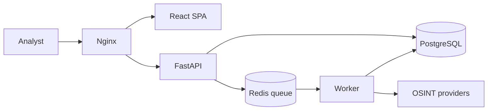

# Architecture

[Documentation](README.md) · [Functional specification](specification.md) · [Development](development.md)



The API never calls a provider. It validates, authorises and enqueues; the worker does the
outbound work. That is why a slow provider cannot make the interface slow, and why the
only component reaching the internet is the one with no inbound port.

## From submission to verdict

1. **Classification.** The observable is typed and refanged — `1.1.1[.]1` becomes an
   address, `hxxps://` becomes a URL. The type decides which plugins may run.
2. **Validation.** Private, loopback and metadata targets are refused unless explicitly
   allowed. The TLP of the job caps which plugins are eligible: a source that publishes
   what it receives cannot run on something that may not be published.
3. **Selection.** From a playbook, or from what the analyst ticked, minus anything
   unconfigured or disabled.
4. **Analysis.** Analyzers run in parallel, bounded by `BACKEND_ANALYZER_MAX_CONCURRENCY`.
   Each one first looks for a valid cached report. Each produces both the provider's raw
   JSON and a normalised summary.
5. **Aggregation.** The summaries are reduced to one verdict — clean, suspicious,
   malicious or unknown.
6. **Connectors.** Run on the finished job, if any were chosen: publish it, or judge it.
7. **Pivots.** On a suspicious or malicious verdict, derive the next observable and create
   child jobs, bounded by per-pivot, per-job and depth limits.

A failure at step 4 is confined to its own report. The job continues.

## Data model

| Entity | Holds |
|---|---|
| `User`, `Group` | Identity from the directory or local, role, group membership and external names |
| `Job` | The observable, its type and TLP, tags, status, timestamps, who asked, and the parent and pivot when it is a child |
| `PluginReport` | One plugin's result for one job: name, type, status, raw payload, summary, errors, duration, whether it came from cache, and what it derived |
| `PluginConfig` | Per-plugin enablement, timeout, cache window, options, health |
| `PluginSecret` | A sealed credential, instance-wide or per user |
| `Playbook` | The plugins of each phase, for one or more observable types |

Raw payloads are stored as JSONB with a partial GIN index, which is what makes
[searching inside them](api.md#searching-inside-the-payloads) fast enough to be useful.

## The plugin framework

Every plugin inherits one abstract base and declares its type as a class attribute. The
registry refuses, at import time, a plugin whose declared type does not match its base
class, an analyzer with no supported observable types, or a pivot with no child playbook.
A mistake is a startup failure, not a runtime surprise.

A plugin returns the raw payload and a normalised summary. The summary is what the
interface shows at a glance and what aggregation reads; the raw payload is what an analyst
drills into.

Details and a worked example: [Writing a plugin](plugin-example/README.md).

## Repository layout

```
xenoproxy/
├── backend/        FastAPI API, arq worker, plugins, migrations, tests
│   └── app/        api/ core/ models/ schemas/ services/ repositories/ plugins/
│       └── plugins/  base/ analyzer/ connector/ pivot/ custom/
├── frontend/       React and TypeScript single-page application
│   └── src/        app/ features/ components/ lib/ styles/
├── deploy/nginx/   Edge reverse proxy configuration
├── docs/           This documentation, the help pages, screenshots and the brand
└── scripts/        Backup, restore-test and cleanup scripts (plain Python)
```

Layering in the backend is one direction only: `api` → `services` → `repositories` →
`models`. Routes hold no SQL and no business logic; repositories hold no HTTP concerns.

The frontend is feature-first: `features/<name>/` owns its pages, components, API calls
and schemas, and something moves to `components/ui/` only when a second feature needs it.
